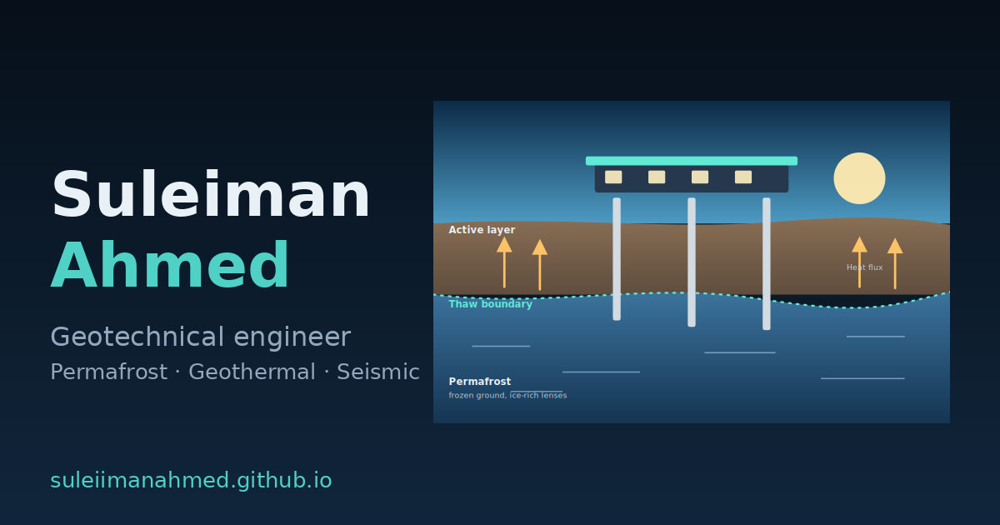

# Suleiman Ahmed

This repository contains the source code for my personal website, built as a lightweight static site and hosted on GitHub Pages.

**Live site:** [suleiimanahmed.github.io](https://suleiimanahmed.github.io/)



## Overview

The site includes pages for:

- Home
- About
- Research
- Projects
- Publications
- Resources
- Experience
- Contact

Each page ends with compact Previous / Next navigation links for easier browsing.

## Features

- Light and dark themes that follow the device preference
- Session-based theme override using the sun/moon toggle
- Publication filtering, citation-copy buttons, and BibTeX download
- Resource filtering by type
- Email address protection using a human-verification step
- Responsive layout with a mobile menu
- Back-to-top button
- Scroll animations that respect reduced-motion preferences
- Search and sharing metadata, including Open Graph, Twitter Cards, schema.org data, a sitemap, web manifest, and app icons
- No frameworks or build step required

## Running locally

You’ll need Git and Python 3 to run the site locally.

```bash
git clone https://github.com/suleiimanahmed/suleiimanahmed.github.io.git
cd suleiimanahmed.github.io
python3 -m http.server 8000
```

Then open [http://localhost:8000/](http://localhost:8000/) in your browser.

## Deployment

This repository must be named `suleiimanahmed.github.io` to use that GitHub Pages URL.

To deploy:

1. Open the repository settings and select **Pages**.
2. Choose **Deploy from a branch**.
3. Select the `main` branch and the root (`/`) folder.
4. Save the settings and push your site files to `main`.

## Project structure

```text
*.html                 Static pages
style.css              Styles, themes, and print rules
site.js                Theme, menu, animation, filter, citation, and email-check behavior
assets/                Project illustrations, social preview image, and other assets
site.webmanifest       Web app manifest
apple-touch-icon.png   App icon
favicon.svg            Favicon
robots.txt             Robots instructions
sitemap.xml            Sitemap
404.html               Not found page
```

## Customizing the site

- Edit the HTML files in the repository root to update page content.
- Edit `style.css` to change styles, themes, and print rules.
- Edit `site.js` to update interactive behavior.
- Add or replace images and icons in `assets/`.

## Notes

- Software names and logos belong to their respective owners and are shown to indicate tools I use, not as endorsements.
- This site is intentionally lightweight and framework-free.

© 2026 Suleiman Ahmed. All rights reserved.
